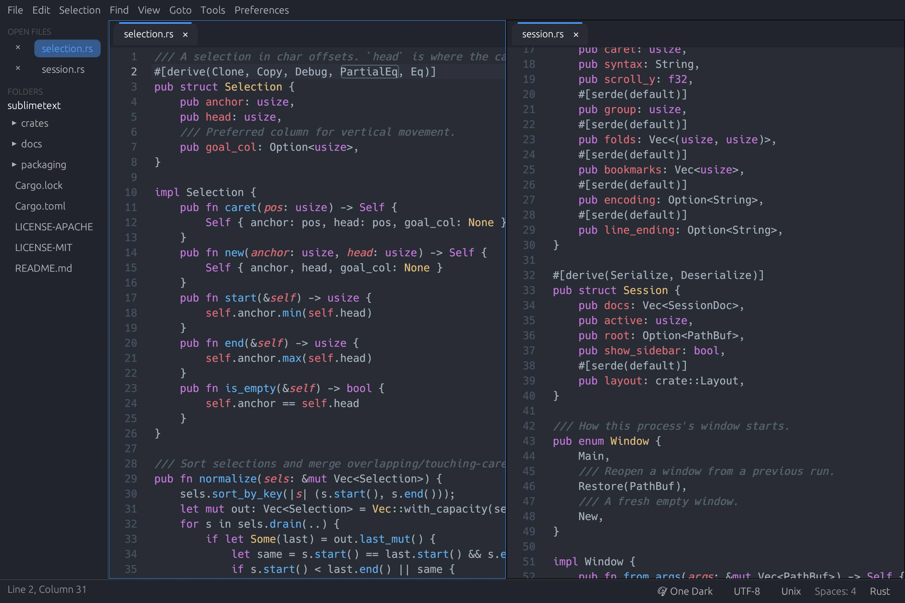
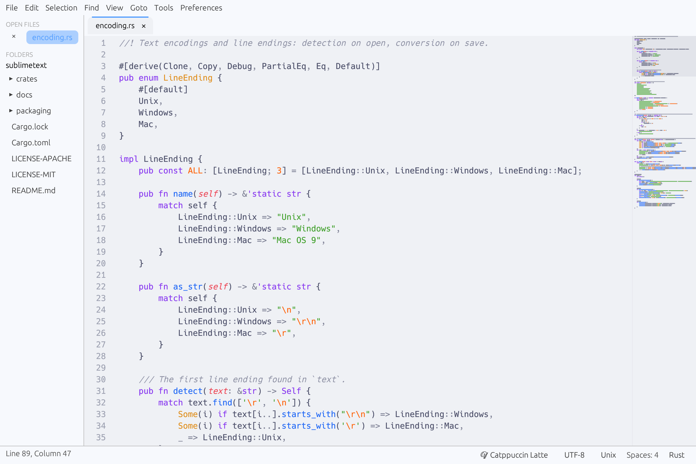
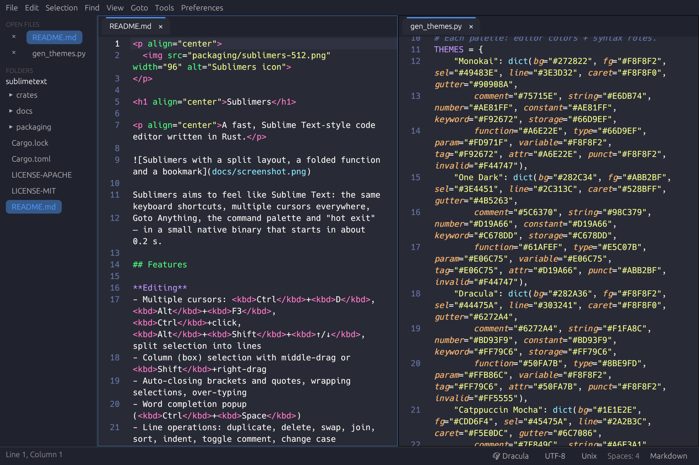

<p align="center">
  
</p>

<h1 align="center">Sublimers</h1>

<p align="center">A fast, Sublime Text–style code editor written in Rust.</p>



Sublimers aims to feel like Sublime Text: the same keyboard shortcuts, multiple cursors everywhere,
Goto Anything, the command palette and "hot exit" — in a small native binary that starts in about 0.2 s.

<table>
  <tr>
    <td></td>
    <td></td>
  </tr>
  <tr>
    <td align="center">Catppuccin Latte, with minimap</td>
    <td align="center">Dracula, word wrap and split view</td>
  </tr>
</table>

## Features

**Editing**
- Multiple cursors: <kbd>Ctrl</kbd>+<kbd>D</kbd>, <kbd>Alt</kbd>+<kbd>F3</kbd>, <kbd>Ctrl</kbd>+click, <kbd>Alt</kbd>+<kbd>Shift</kbd>+<kbd>↑/↓</kbd>, split selection into lines
- Column (box) selection with middle-drag or <kbd>Shift</kbd>+right-drag
- Auto-closing brackets and quotes, wrapping selections, over-typing
- Word completion popup (<kbd>Ctrl</kbd>+<kbd>Space</kbd>)
- Line operations: duplicate, delete, swap, join, sort, indent, toggle comment, change case
- Undo/redo with grouped typing, soft undo

**Navigation**
- Goto Anything (<kbd>Ctrl</kbd>+<kbd>P</kbd>) with `@symbol`, `:line` and `#word`
- Command palette (<kbd>Ctrl</kbd>+<kbd>Shift</kbd>+<kbd>P</kbd>)
- Find / replace with regex, case and whole-word options; Find in Files
- Bookmarks, jump to matching bracket

**View**
- Syntax highlighting for every `.sublime-syntax` grammar syntect ships, plus your own
- Color schemes: Monokai, One Dark, Dracula, Catppuccin, Nord, Gruvbox, Tokyo Night, Mariana, GitHub Light and more, with live preview
- Split layouts (columns, rows, grid), word wrap, code folding, minimap
- Highlighting of the word under the caret and of matching brackets

**Files**
- Hot exit: unsaved changes and open files survive closing the app
- Multiple windows (<kbd>Ctrl</kbd>+<kbd>Shift</kbd>+<kbd>N</kbd>), each restored on the next launch
- Encodings (UTF-8/16, Greek, Western, Cyrillic, …) with auto-detection; Unix/Windows line endings
- Reloads files changed on disk, and asks when you have unsaved edits
- Sidebar with preview tabs and file operations (new, rename, move to trash)

## Install

Download the package for your system from the [latest release](https://github.com/genetzhs/sublimers/releases/latest).
All builds are for 64-bit x86 Linux.

### AppImage (any distribution)

```sh
chmod +x Sublimers-x86_64.AppImage
./Sublimers-x86_64.AppImage [file or folder…]
```

### Debian / Ubuntu / Linux Mint (.deb)

```sh
sudo apt install ./sublimers_0.1.1_amd64.deb
```

### Fedora / RHEL / openSUSE (.rpm)

```sh
sudo dnf install ./sublimers-0.1.1-1.x86_64.rpm      # Fedora, RHEL
sudo zypper install ./sublimers-0.1.1-1.x86_64.rpm   # openSUSE
```

### Other distributions (.tar.gz)

```sh
tar xzf sublimers-0.1.1-x86_64-linux.tar.gz
./sublimers-0.1.1-x86_64-linux/sublimers
```

Verify downloads with `sha256sum -c SHA256SUMS`.

## Updating

Sublimers checks GitHub for a new release once a day, and on demand from **Help → Check for Updates…**.
When one is available, a notice appears in the status bar and a single click updates the app:

| Installed from | How it updates |
|---|---|
| AppImage | Downloads the new AppImage and replaces the old file in place |
| .deb | Downloads the new package and installs it with `apt` (asks for your password) |
| .rpm | Downloads the new package and installs it with `dnf` / `zypper` (asks for your password) |
| .tar.gz or source | Links to the release page |

Unsaved work survives the restart thanks to hot exit. The AppImage also carries update information,
so [AppImageUpdate](https://github.com/AppImageCommunity/AppImageUpdate) can update it with delta downloads.

## Build from source

Requires a recent stable Rust toolchain.

```sh
git clone https://github.com/genetzhs/sublimers
cd sublimers
cargo run --release -p sublimers -- .
cargo test
```

To build all release packages (AppImage, .deb, .rpm, .tar.gz and checksums) into `dist/`:

```sh
cargo install cargo-generate-rpm
packaging/build-release.sh /path/to/appimagetool
```

## Configuration

Settings and key bindings live in `~/.config/sublimers/`, in the same JSON format as Sublime Text:

- `Preferences.sublime-settings` — `color_scheme`, `font_size`, `tab_size`, `translate_tabs_to_spaces`, `word_wrap`, `minimap`, `rulers`, `auto_match_enabled`, …
- `Default.sublime-keymap` — override any binding, e.g. `{"keys": ["ctrl+k", "ctrl+b"], "command": "toggle_side_bar"}`
- `syntaxes/` and `themes/` — drop in extra `.sublime-syntax` and `.tmTheme` files

Open them from **Preferences → Settings / Key Bindings**.

## Project layout

| Crate | Purpose |
|---|---|
| `crates/core` | Text buffer (rope), selections, undo, editing commands, search, folds, encodings |
| `crates/syntax` | Highlighting and color schemes on top of syntect |
| `crates/app` | The egui application: views, tabs, panels, palette, sessions |

## License

Copyright © 2026 Genetzakis Manolis.

Licensed under either of [Apache License, Version 2.0](LICENSE-APACHE) or [MIT license](LICENSE-MIT) at your option.

Sublime Text is a trademark of Sublime HQ Pty Ltd. This project is not affiliated with or endorsed by Sublime HQ.
